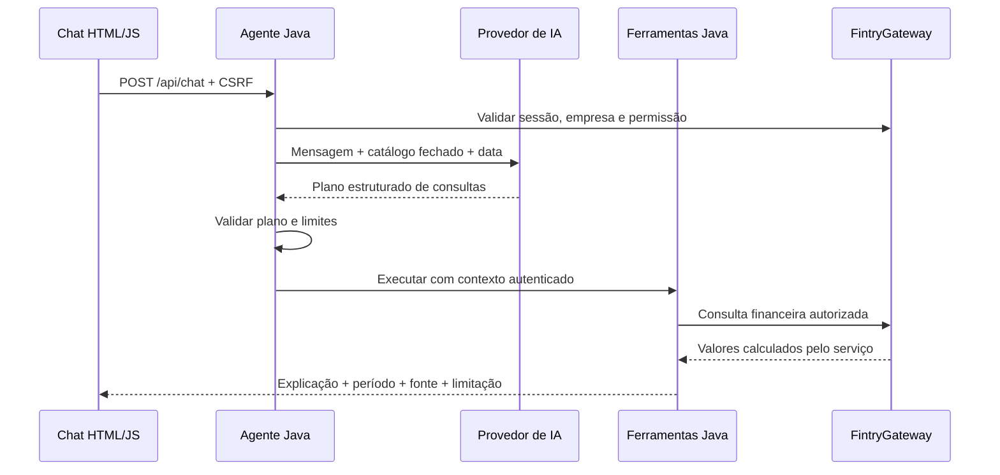

# Fintry AI Agent

Assistente financeiro de **somente consulta**, com Java 21, Spring Boot, Spring AI e uma interface responsiva servida pela própria aplicação. Versão **0.1.0**.

Projeto pessoal para praticar IA aplicada, integração HTTP, isolamento entre empresas, testes e decisões de arquitetura explicáveis. O Fintry Finance continua independente: nenhum código, interface ou banco dele foi alterado.

## Executar a demonstração

Pré-requisito: JDK 21. O Maven Wrapper baixa o Maven e as dependências na primeira execução.

```powershell
.\mvnw.cmd spring-boot:run
```

Linux/macOS:

```sh
chmod +x mvnw
./mvnw spring-boot:run
```

Abra [localhost:8092](http://localhost:8092). A porta 8092 evita conflito com os serviços já em execução neste ambiente. Para mudar a porta local, use `PORT`; no Compose, use `AGENT_HTTP_PORT`. Não é necessário banco, Fintry, chave de IA ou login para a demonstração. A tela identifica **dados fictícios** e **provedor simulado**. Não exponha a demonstração como se fosse um ambiente autenticado com dados reais.

Perguntas prontas:

- “Qual é meu saldo disponível?”
- “Quais contas vencem nos próximos sete dias?”
- “Quanto entrou e saiu neste mês?”
- “Como está meu fluxo de caixa previsto?”

O provedor simulado é um roteador determinístico limitado, não um modelo generativo. Trabalha com as perguntas acima e pequenas variações; não mantém memória de conversa. Para outro período, use `resumo AAAA-MM` ou `projeção de caixa em 15 dias`. A demonstração contém resumo somente do mês atual; meses sem dados retornam uma limitação explícita. As datas seguem `America/Sao_Paulo`.

Dados da demonstração: saldo atual R$ 12.500,00; entradas realizadas R$ 18.000,00; saídas R$ 8.500,00; resultado R$ 9.500,00. O saldo de abertura do mês é implicitamente R$ 3.000,00. Há duas despesas pendentes, R$ 1.800,00 em D+2 e R$ 700,00 em D+5, e uma receita de R$ 5.000,00 em D+7. Na projeção de 30 dias, o saldo final é R$ 15.000,00 e o menor saldo é R$ 10.000,00. Esses cálculos ficam no serviço financeiro demonstrativo, nunca no modelo.

## Docker

```sh
cp .env.example .env
docker compose up --build
```

No PowerShell use `Copy-Item .env.example .env`. O Compose lê `.env`; o Spring Boot executado diretamente **não** o carrega automaticamente. No processo Java local, exporte as variáveis no terminal.

A imagem compila e executa os testes com JDK 21, depois roda com JRE 21 e usuário sem privilégios. O Compose publica apenas em `127.0.0.1`, usa filesystem somente leitura e `/tmp` temporário. Pare com `docker compose down`. Health check HTTP: `GET /health` (vitalidade da aplicação, não comprova disponibilidade do Fintry ou da IA).

## Modelo real por API

É possível usar IA real com os dados fictícios antes de conectar o Fintry:

```powershell
$env:AI_PROVIDER = 'openai'
$env:AI_API_KEY = '<sua-chave-local>'
$env:AI_MODEL = 'gpt-4o-mini'
.\mvnw.cmd spring-boot:run
```

`AI_BASE_URL` permite uma API compatível com o protocolo OpenAI Chat Completions e saída JSON. Use uma origem confiável: a chave é enviada a esse endereço. O adaptador usa Spring AI `ChatClient` e conversão estruturada para selecionar ferramentas. O modelo recebe a mensagem escrita pelo usuário, o catálogo de consultas e a data de Brasília. Cookies, identidade, permissões e resultados financeiros das ferramentas não são enviados ao provedor. **O próprio usuário pode incluir informações sensíveis no texto**, portanto considere a política de dados do provedor antes de usar dados reais.

Uma requisição ao modelo por pergunta; saída limitada a 600 tokens; sem tentativas automáticas de repetição. Consultas podem gerar cobrança mesmo quando a resposta falhar ou o prazo local expirar. Preço depende do modelo e dos tokens de entrada/saída; consulte a [tabela oficial do provedor](https://openai.com/api/pricing/) e configure limites de gastos na sua conta. Não há cobrança de IA em `AI_PROVIDER=simulated`. Não foram feitas chamadas pagas durante o desenvolvimento desta versão.

## Integração real com Fintry

O código de referência foi inspecionado no commit [`9c6c099`](https://github.com/FrancaCODEX/fintry-finance/tree/9c6c099c0df21553d42c95548d39557c1aa9bbf5), versão 0.39.1. Ele usa **sessão HTTP e CSRF**, não JWT. Há APIs GET existentes para todas as consultas desta entrega. Consulte [o contrato e a implantação com sessão](docs/fintry-integration.md).

```powershell
$env:FINTRY_MODE = 'real'
$env:FINTRY_BASE_URL = 'http://localhost:8080'
.\mvnw.cmd spring-boot:run
```

Essa configuração exige uma sessão válida do usuário no Fintry; sozinha não cria um login. A interface deve ser servida no mesmo host por um proxy, sob `/agent/`, preservando o cookie `JSESSIONID` que o Fintry já emite. O Agent usa outro cookie para o seu próprio CSRF. Não copie cookies para o prompt, `.env`, arquivos versionados ou uma credencial global de aplicação. A integração real **não tem fallback para dados demonstrativos**.

| Parte | Situação nesta versão |
| --- | --- |
| Chat, ferramentas, períodos e evidências | Implementados e testados de ponta a ponta em demonstração |
| Serviço financeiro demonstrativo | Fictício, determinístico e identificado na tela |
| Provedor de demonstração | Simulado; não é LLM |
| Provedor Spring AI por API | Implementado; contrato testado com resposta de modelo controlada, sem consumo pago |
| Adaptador HTTP Fintry | Implementado sobre endpoints existentes; testado com servidor HTTP local de contrato |
| Sessão/empresa/permissões | Validadas em `/auth/me` e revalidadas antes de cada ferramenta; upstream também aplica autorização |
| Conexão com uma instância real do Fintry | Depende do proxy e da sessão; não homologada com conta real nesta entrega |
| Operações de escrita, SQL e acesso ao banco | Não existem no catálogo ou no adaptador |

## Como funciona



- **Modelo:** interpreta linguagem e propõe ferramentas e argumentos. Não é fonte de valores, calculadora, autenticador ou autorizador.
- **Agente:** coordena validação de identidade, planejamento e execução limitada. A saída do modelo é entrada não confiável.
- **Ferramentas:** catálogo Java tipado de saldo, resumo, pendências e projeção; verificam argumentos e permissão, formatam evidências sem gerar números.
- **Serviços financeiros:** calculam saldo, realizados, pendências e projeções. Na integração real, esses cálculos continuam no Fintry Finance; na demonstração, no `DemoFintryGateway`.
- **Integração:** `FintryGateway` separa o domínio da API HTTP e dos dados fictícios.
- **Chat:** apresentação de texto e evidências, com `textContent`, sem executar HTML retornado pelo modelo ou pelas descrições financeiras.

Pacotes por responsabilidade funcional: `chat`, `orchestration`, `ai`, `tools`, `integration`, `config`. É uma aplicação única, sem banco próprio, memória de conversa ou microsserviços. O planejamento estruturado substitui um loop autônomo aberto: o modelo propõe uma lista limitada e o Java executa explicitamente cada ferramenta. A explicação final é determinística para manter números e fontes rastreáveis. Veja as [decisões e roteiro para entrevista](docs/architecture.md).

## Limites e segurança

| Controle | Limite |
| --- | --- |
| Mensagem | 1–2.000 caracteres; JSON até 8 KiB |
| Plano | Até 3 consultas; `AGENT_MAX_TOOLS` aceita 1–3 |
| Tempo total, incluindo autenticação e modelo | 20 segundos; `AGENT_TIMEOUT_SECONDS` aceita 1–30 |
| Concorrência | 4 consultas em execução; excedentes retornam 429, sem fila |
| HTTP Fintry | Conexão 2 s, requisição 5 s, corpo até 1 MiB, sem redirects |
| IA | Conexão 2 s, leitura 10 s, 600 tokens de saída, uma tentativa |
| Resumo | Mês atual ou últimos 24 meses; dados disponíveis no serviço |
| Pendências | Amanhã até hoje+7 inclusive; primeiras 20 despesas e total completo do servidor |
| Projeção | Hoje até hoje+N inclusive, N=1–90; exclui atrasados |

Sessão ou permissão inválida interrompe a consulta. Falha de uma ferramenta é exibida sem inventar valores; uma resposta parcial mantém os resultados das ferramentas que funcionaram. Não há campos de empresa ou usuário nos argumentos das ferramentas. Cabeçalhos `X-Company-Id` e similares não concedem acesso. Injeções de prompt não podem adicionar métodos de escrita ou caminhos HTTP arbitrários porque eles não existem neste processo.

Não há logs de mensagens, cookies, prompts ou respostas financeiras; logs internos do Spring AI são desativados. Erros HTTP não propagam corpo ou stack trace do Fintry. Não habilite logs HTTP detalhados em produção. Use HTTPS e `COOKIE_SECURE=true` no proxy. Proteção CSRF permanece ativa no chat. Requisições e respostas de `/api/*` usam `Cache-Control: no-store`.

## Testar

```powershell
.\mvnw.cmd -B verify
node --check src/main/resources/static/app.js
docker compose config --quiet
docker build -t fintry-ai-agent:local .
```

Testes cobrem roteamento simulado, conversão estruturada do Spring AI, execução e evidências, Brasília na virada UTC, argumentos maliciosos, mensagens excessivas, CSRF, ferramentas inexistentes, empresas diferentes em consultas simultâneas, sessão expirada, troca de empresa, permissão revogada, indisponibilidade, campos financeiros ausentes e resposta HTTP excessiva. Não exigem API paga nem banco. CI repete verificação Java, sintaxe JS e build Docker.

Se o Java iniciado pelo aplicativo desktop no Windows falhar com `Unable to establish loopback connection`, um diretório temporário curto para sockets resolve o problema observado neste ambiente: `New-Item -ItemType Directory -Force C:\Temp\fintry-java` e `$env:JAVA_TOOL_OPTIONS='-Djdk.net.unixdomain.tmpdir=C:/Temp/fintry-java'`, antes de executar o Wrapper. Isso é uma configuração local de execução, não uma dependência da aplicação.

## Versões e fontes

Java 21 + Spring Boot **3.5.16** + Spring AI **1.1.8**, com BOM do Spring AI, parent do Boot e Maven Wrapper **3.9.16**. São versões estáveis de uma linha compatível; não usamos snapshots. A linha mais recente do Spring AI 2.x exigiria Boot 4.x. Mantivemos 1.1.x/3.5.x para uma primeira versão pequena com APIs estabilizadas e compatibilidade explicitamente documentada.

- [Compatibilidade no código oficial da documentação Spring AI 1.1.8](https://github.com/spring-projects/spring-ai/blob/v1.1.8/spring-ai-docs/src/main/antora/modules/ROOT/pages/getting-started.adoc): Boot 3.4.x/3.5.x.
- [Release estável Spring AI 1.1.8](https://spring.io/blog/2026/06/12/spring-ai-1-1-8-1-0-9-avaialble-now/).
- [Requisitos Java/Maven do Boot 3.5.16](https://docs.spring.io/spring-boot/3.5/system-requirements.html).

## Próximos incrementos

Homologar o proxy com uma instância de desenvolvimento do Fintry e duas contas de empresas distintas; testar provedores reais com um conjunto de perguntas e medir custo/latência; adicionar períodos arbitrários apenas quando houver contratos financeiros adequados. Memória de conversa exige armazenamento e isolamento explícitos e fica para outra entrega.
